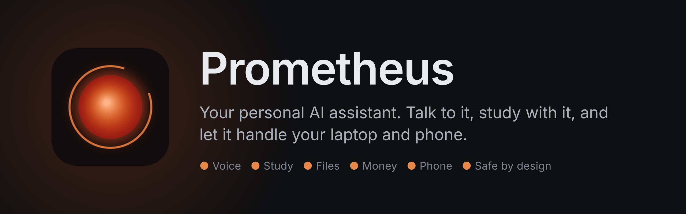

<p align="center"></p>

<p align="center">
  <a href="https://github.com/Reevias/Prometheus-/releases/latest"></a>
  <a href="https://github.com/Reevias/Prometheus-/actions/workflows/tests.yml"></a>
  
  
  <a href="LICENSE"></a>
</p>

<p align="center">
  <a href="https://github.com/Reevias/Prometheus-/releases/latest/download/Prometheus-Setup.exe"></a>
  <a href="https://github.com/Reevias/Prometheus-/releases/latest/download/Prometheus.apk"></a>
</p>

<p align="center">Or in PowerShell: <code>irm https://raw.githubusercontent.com/Reevias/Prometheus-/main/scripts/install-windows.ps1 | iex</code><br>
<sub>by <a href="https://github.com/Reevias">Reevias</a></sub></p>

| | | |
|---|---|---|
| 🎙️ **Voice**<br>Say "Prometheus" or clap twice. Natural voice, understands Hinglish, you can interrupt it. | 📚 **Study**<br>Flashcards and quizzes from your notes, exam planner, lecture notes, homework hints. | 💸 **Money**<br>Spending from bank emails and SMS, budgets with warnings. |
| 📁 **Files**<br>Finds, sorts and reads your files; writes Word, PDF, Excel and slides. Every change undoable. | 🖥️ **Your laptop**<br>Sees your screen, opens apps, uses websites, runs code safely. | 📱 **Your phone**<br>An app with notifications, plus control of your Android phone. |
| ☀️ **Every day**<br>Morning brief, reminders, focus mode, a weekly report card. | ☁️ **Always on**<br>A cloud copy that works while the laptop is off, encrypted backups. | 🛡️ **Safe**<br>Asks before anything big, never pays without you, one switch stops everything. |

## Everything it does

**Everyday:** chat or talk ("Hello Prometheus…"), instant answers (time, opening apps, timers, volume, weather),
reminders and standing goals, a morning briefing and evening wrap-up, focus mode, "undo that".

**Your stuff:** finds, sorts and undoably moves files; searches inside your documents; reads PDFs, Word, Excel and
slides; writes Word, PDF, Excel and PowerPoint files; your photos tagged and sorted; Obsidian notes; clipboard and
screenshot memory; email (Gmail in one click), Google Calendar and Drive; a money tracker from bank emails and SMS.

**Study:** flashcards and quizzes from your notes (chat or voice, spaced review, Anki export, quiz PDFs), an exam
countdown planner, lecture recordings to notes and slides, read-aloud with "explain that again", a homework checker
that gives hints (never answers), an assignment tracker.

**Computer and phone:** sees your screen ("what's this error?", "click the blue button"), uses websites in its own
browser, controls Wi-Fi, apps and settings; controls your Android phone (apps, screen, settings, alarms, WhatsApp,
calls); runs Python safely in a sandbox; can learn GitHub repos as skills (checked for malware first).

**Always with you:** an installable phone app with notifications, an always-on cloud copy that syncs with the
laptop, encrypted nightly backups to Google Drive, and use from other AI apps (Antigravity, Claude Desktop) over MCP.

**Brains:** Claude, 21 models on OpenRouter (Kimi K3, Qwen 3.8 2.4T, DeepSeek V4, GPT-6.1, Gemini 4…), free models,
or a private model on the laptop. Your files only ever go to the local model unless you say otherwise.

**Safety:** small actions asked in the chat, big ones on the Approvals page, paying always approved, every file
change undoable, a built-in prompt-injection safety check, a spending limit.

## Install on Windows

**One line**, in PowerShell:

```powershell
irm https://raw.githubusercontent.com/Reevias/Prometheus-/main/scripts/install-windows.ps1 | iex
```

**Or download the installer:** [Prometheus-Setup.exe](https://github.com/Reevias/Prometheus-/releases/latest/download/Prometheus-Setup.exe)
(from the [Releases](https://github.com/Reevias/Prometheus-/releases) page). Windows may say "Windows protected your
PC" because the file isn't signed: click **More info**, then **Run anyway**.

Either way it gets Git and Python if they're missing, downloads Prometheus to `%USERPROFILE%\Prometheus-`, asks you
to choose a password (first time only, at least 10 characters) and puts **Prometheus**, with its own icon, on your
desktop and in the Start menu. Run it again any time to update.

**Remove it** (your memory, chats, settings and keys are kept for the next install):

```powershell
irm https://raw.githubusercontent.com/Reevias/Prometheus-/main/scripts/uninstall-windows.ps1 | iex
```

## On your phone

**Android:** download [Prometheus.apk](https://github.com/Reevias/Prometheus-/releases/latest/download/Prometheus.apk)
in Chrome on the phone and open it (Android asks once to allow installing from Chrome). **iPhone:** add it to the
home screen from Safari. Either way you get notifications, hold-to-talk and sending photos:

1. Set up the always-on **cloud copy** once (free Oracle Cloud machine): [`docs/cloud-setup.md`](docs/cloud-setup.md).
2. Install **Tailscale** on the phone and sign in.
3. On the laptop open ☰ → **Get it on your phone**, scan the QR code and follow the steps there.

Everything else (notifications, bank SMS, letting Prometheus control the phone): [`docs/phone-setup.md`](docs/phone-setup.md).

## Run

Double-click the **Prometheus** shortcut. It always opens this copy, never an older one. The version is shown in
the window title.

To update: ask Prometheus to update itself (after your approval), or run:

```powershell
cd $env:USERPROFILE\Prometheus-
.venv\Scripts\python -m prometheus.cli update
```

Other commands (after `.venv\Scripts\activate`): `prometheus serve` (browser tab at http://127.0.0.1:8000),
`prometheus doctor` (checks the setup and warns if you are running an old copy), `prometheus shortcut`.

**Voice:** say **"Prometheus"** and then what you want, or **clap twice** to be greeted with a short brief and then just
talk. You can interrupt it while it speaks. The installer sets it up and starts it with Windows. Or by hand:
`pip install -e ".[voice]"`, then `prometheus voice-setup` (downloads about 250 MB once) and `prometheus autostart on`.
For a chatbot-level voice, paste an **ElevenLabs** key in Settings → Voice: it understands accents and Hinglish much
better and sounds natural. Without the key, everything is heard and spoken on the laptop. Click the mic pill to mute.

**Your chats as files:** every chat is saved in `%USERPROFILE%\Prometheus memory` (one file per chat in
`chats\`, one file per topic in `topics\` linking every chat about it, and `index.md`). It is in your home
folder, not Documents, because Documents is often synced to OneDrive. Prometheus fetches only the matching parts of
earlier chats for a new question, never whole chats.

**Meaning-based memory search:** the installer gets `embeddinggemma-2:270m` through Ollama. Without it, memory search uses words.

## AI models

Add keys in **Settings → API keys** (paste the key, type your Prometheus password, Save). Keys stay on this
laptop, are never shown again, and work straight away.

- **OpenRouter (main brain for now):** one key, many models.
- **Free providers:** Settings lists Groq, Gemini, Mistral, NVIDIA and others, with a search box. Tick "Use it"
  to switch one on. Three need no key (Kilo Code, LLM7.io, OVHcloud) but have tight limits. Providers marked
  "may log or train on prompts" can keep what you send them.
- **Local (free, private):** Ollama with `granite4.2:3b` (2.2 GB; the installer gets it). Personal files only ever go to local models.
- **Ollama cloud:** big open models (Kimi K3.1 Pro, GLM 5.3, DeepSeek V4.1, Mistral Large 4, gpt-oss 120B…) run on Ollama's computers. Paste an Ollama key (ollama.com/settings/keys) in Settings → AI and pick one as the Brain. Never used for private files.
- **Coding brain:** requests about code are planned by Ripple 65B (Ricursive, on OpenRouter, $0.20 / $0.60 per million tokens) when you have an OpenRouter key; otherwise by the normal Brain.
- **Claude:** add an Anthropic key later. Use prepaid credit with auto-reload off.

Prometheus switches models by itself: if one is down, out of credit or rate-limited it rests for 5 minutes and
the next one takes over; when the spending cap is reached it drops to free and local models. Each answer shows
which model wrote it.

Without any model, file sorting by rules still works; planning needs a model.

## Skills

Skills are how-to guides Prometheus follows. Each is a folder with a short `SKILL.md` and a `references/` folder
it opens only when needed (see the **Skills** page). Built-in skills: research, task-planning, memory, models,
coding, understand-software, explain-code, file-sorting, video. They were written from the open-source projects
named inside each reference file.

Add your own: put a folder with a `SKILL.md` (starting with `name:` and `description:` lines between `---` marks)
in the `skills` folder of Prometheus's data folder. A skill is instructions the AI will follow, so only add ones
you trust.

## Memory

Everything Prometheus remembers is in one file (`memory.db`) shared by every agent and model. Before planning it
looks up the memories that match your request. The **Memory** page has a search box; word forms and partial
words match ("tax" finds "taxes").

## Safety

- Opens only on your laptop (`127.0.0.1`) and needs your password. Phone access on Wi-Fi is an opt-in setting.
- Never deletes: files go to the Recycle Bin, and every move can be undone on the **History** page.
- Agents can only reach your user folder; system folders, browser data, passwords, `.ssh` and Prometheus's own code
  are always blocked.
- Text from files and web pages is treated as data, never as instructions.
- Web requests can't reach your own network or computer.
- YouTube and GitHub links open straight away; any other website or any file on your laptop waits for your
  approval; programs and scripts are never opened.
- Cloning repos and self-edits wait on the **Approvals** page. The safety code itself can't be self-edited.
- **STOP ALL** at the top of every page stops every agent at once.

Your data lives in `%LOCALAPPDATA%\Prometheus` (memory, undo history, prompts, settings).

## For developers

```bash
uv venv -p 3.14 .venv && uv pip install -e ".[dev]"
.venv/bin/pytest -q
```

## More

- [Changelog](CHANGELOG.md)
- [Security](SECURITY.md)
- [Contributing](CONTRIBUTING.md)
- [All decisions so far](docs/brief.md)
- [`website/`](website/): the separate sign-up/login website moved here from the old repository
- Licence: [MIT](LICENSE)
