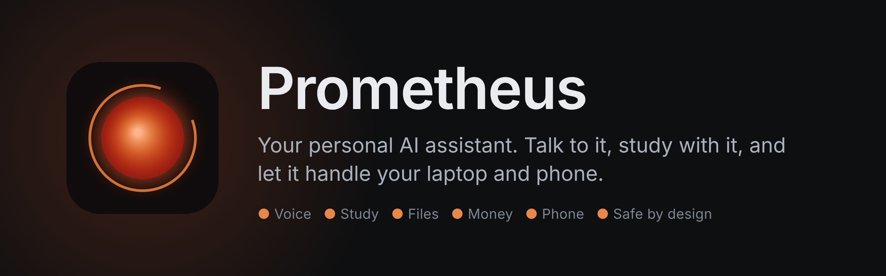

<p align="center"></p>

<h3 align="center">Your personal AI, on your own laptop.</h3>

<p align="center">
  <a href="https://github.com/Reevias/Prometheus-/releases/latest"></a>
  <a href="https://github.com/Reevias/Prometheus-/actions/workflows/tests.yml"></a>
  
  
  <a href="LICENSE"></a>
</p>

<p align="center">
  <a href="https://github.com/Reevias/Prometheus-/releases/latest/download/Prometheus-Setup.exe"></a>
  <a href="https://github.com/Reevias/Prometheus-/releases/latest/download/Prometheus.apk"></a>
</p>

<p align="center">Or in PowerShell: <code>irm https://raw.githubusercontent.com/Reevias/Prometheus-/main/scripts/install-windows.ps1 | iex</code><br>
<sub>by <a href="https://github.com/Reevias">Reevias</a></sub></p>

> **Where this is.** `main` has Prometheus 3.0 up to milestone **M6**: the new interface (M2), a step-by-step agent
> engine with model routing (M3), skills learned from GitHub repositories (M4), many agents at once with a jobs view
> (M5), and M6: one runtime for every job, **Cloudroom** (your free Render service can run a script for you after your
> yes), encrypted storage on Google Drive, control of the laptop's screen, mouse and keyboard, the phone controlling the
> laptop, and phone control through mobile-mcp. It is not released yet (the version stays 2.3.0 until the plan is
> done), so the downloads above are still the v2.3 release. Not everything is checked on the owner's own laptop yet:
> see the milestone reports in [`docs/reports/`](docs/reports/). The full plan is in [`docs/PLAN.md`](docs/PLAN.md).

## Why Prometheus

Most assistants are a website with your files attached. Prometheus is the other way round: it runs on the laptop you
already own, keeps your memory and your files there, and reaches for the internet only when a task needs it.

- **Local first.** Your memory, chats, notes and file index live in one SQLite file on your laptop. Private files are
  never sent to a cloud model; they go to the local model, or nowhere.
- **Free first.** It works with free models and a small local model out of the box. Paid keys are optional, have a
  spending cap, and every answer tells you which model wrote it.
- **One brain, many hands.** A planner splits a request into steps and hands each step to a specialist agent that has
  the fewest permissions that do the job.
- **Nothing irreversible without you.** Files go to the Recycle Bin, every move is undoable, big actions wait on an
  approvals page, and one switch stops everything.

## What it does today

| | | |
|---|---|---|
| 🎙️ **Voice**<br>Say "Prometheus" or clap twice. Natural voice, understands Hinglish, and you can interrupt it. | 📚 **Study**<br>Flashcards and quizzes from your notes, an exam planner, lecture notes, homework hints. | 💸 **Money**<br>Spending from bank and UPI emails and SMS, budgets with warnings. |
| 📁 **Files**<br>Finds, sorts and reads your files; writes Word, PDF, Excel and slides. Every change undoable. | 🖥️ **Your laptop**<br>Sees your screen, opens apps, uses websites, runs code safely. | 📱 **Your phone**<br>An app with notifications, plus control of your Android phone. |
| ☀️ **Every day**<br>Morning brief, reminders, focus mode, a weekly report card. | ☁️ **Always on**<br>A cloud copy that works while the laptop is off, and encrypted backups. | 🛡️ **Safe**<br>Asks before anything big, never pays without you, one switch stops everything. |

**The details**

- **Everyday:** chat or talk, instant answers (time, opening apps, timers, volume, weather), reminders and standing
  goals, a morning briefing and evening wrap-up, focus mode, "undo that".
- **Your stuff:** finds and sorts files, searches inside documents, reads PDF/Word/Excel/slides, writes Word, PDF,
  Excel and PowerPoint, tags photos, reads Obsidian notes, remembers your clipboard and screenshots, Gmail, Google
  Calendar and Drive, a money tracker from bank emails and SMS.
- **Study:** flashcards and quizzes (spaced review, Anki export, quiz PDFs), an exam countdown planner, lecture
  recordings to notes and slides, read-aloud, a homework checker that gives hints and never the answer, an assignment
  tracker.
- **Computer and phone:** sees your screen ("what's this error?"), reads, clicks and types on the laptop (every click
  or typed text asks first), uses websites in its own browser, controls Wi-Fi, apps and settings, controls an Android
  phone through mobile-mcp (taps and typing ask first), lets your paired phone control the laptop, runs Python in a
  sandbox (on the laptop, or in Cloudroom when you ask), and can learn a GitHub repository as a skill after checking it.
- **Always with you:** an installable phone app with notifications, Cloudroom on your free Render service, encrypted
  backups and Cloudroom storage on Google Drive (sealed on the laptop first), and use from other AI apps over MCP.

## Built-in agents

A request is split by the planner and given to these agents. Each one has its own permissions, so an agent that reads
your files cannot also spend money.

| | Agents | What they cover |
|---|---|---|
| 🔎 | `research` `wikipedia` `documents` `translate` `guide` | Web research with sources, facts, reading your PDFs and Word files, translation, how-to answers from the skills |
| 📚 | `study` `exams` `assignments` `homework` `lecture` `reader` | Flashcards and quizzes, revision plans, deadlines, homework hints, class recordings to notes, read-aloud |
| 📁 | `files` `file_sorter` `photos` `obsidian` `clipboard` `undo` | Finding and changing files, tidying a folder, photo search, notes, clipboard history, undo |
| 💸 | `money` `reminders` `briefing` `focus` `health` `jobs` | Spending, reminders and goals, morning brief, focus mode, laptop health, ready-made jobs |
| 🖥️ | `browser` `screen` `system` `opener` `code` `tools` `apps` `antigravity` | Websites step by step, screen reading, Wi-Fi and settings, opening things, sandboxed Python, your own tools, connected apps, cloud jobs |
| 📱 | `phone` `google` `calendar` `email` `github` `repo_scout` | Android control, Google Calendar and Drive, Gmail, GitHub reading and pull requests, repository search |
| ⚙️ | `settings` | Which model is ready, and switching it |

## Skills

Skills are how-to guides the planner follows for a kind of work. Each is a folder with a `SKILL.md` plus references it
opens only when needed.

| Skill | Use it for |
|---|---|
| `research` | Web research and a cited report, from a quick answer to a deep dive |
| `task-planning` | Breaking a request into a dependency-ordered plan and recovering from failures |
| `memory` | Saving, recalling, correcting or forgetting facts |
| `models` | Choosing, adding and switching AI models and providers |
| `coding` | The coding agent, its model provider, and self-editing design |
| `explain-code` | Mapping a codebase as a graph, or explaining code to a beginner |
| `understand-software` | Working out how an app, site or game you own is built |
| `file-sorting` | Tidying a folder and undoing it |
| `learning-roadmap` | A study plan for a subject, with stages and free books |
| `video` | Opening or summarising a YouTube video, narration, AI video |

Add your own by putting a folder with a `SKILL.md` (starting with `name:` and `description:` between `---` marks) in
the `skills` folder of Prometheus's data folder. A skill is instructions the AI will follow, so only add ones you trust.

## Install on Windows

**One line**, in PowerShell:

```powershell
irm https://raw.githubusercontent.com/Reevias/Prometheus-/main/scripts/install-windows.ps1 | iex
```

**Or download the installer:** [Prometheus-Setup.exe](https://github.com/Reevias/Prometheus-/releases/latest/download/Prometheus-Setup.exe)
(from the [Releases](https://github.com/Reevias/Prometheus-/releases) page). Windows may say "Windows protected your
PC" because the file isn't signed: click **More info**, then **Run anyway**.

Either way it gets Git and Python if they're missing, downloads Prometheus to `%USERPROFILE%\Prometheus-`, asks you
to choose a password (first time only, at least 10 characters) and puts **Prometheus**, with its own icon, on your
desktop and in the Start menu. Run it again any time to update.

**Remove it** (your memory, chats, settings and keys are kept for the next install):

```powershell
irm https://raw.githubusercontent.com/Reevias/Prometheus-/main/scripts/uninstall-windows.ps1 | iex
```

## The interface

One look on the laptop and the phone (dark, with an orange core):

- **Home**: ask anything; `/` opens commands and `@` picks an agent. On the laptop a right panel shows live CPU,
  memory and disk, the agent at work and the current task.
- **Chats** and **Projects** (a folder, its chats, notes and your instructions together; export and import as .zip).
- **Agents**, **Skills**, **Memory** (saved facts, documents, topics, what it learned), **Tasks** (list, board,
  timeline or table; pause and carry on), **Automations** (once, repeating, or when something happens, like a new file
  or a low battery; each can ask you first), **Research** (with Study and Money modes) and **System** (this laptop,
  your devices, and everything Prometheus did, with undo).
- Your name at the bottom opens Settings, Connections, Approvals and more. Stop all is always at the top.

## On your phone

**Android:** download [Prometheus.apk](https://github.com/Reevias/Prometheus-/releases/latest/download/Prometheus.apk)
in Chrome and open it (Android asks once to allow installing from Chrome). **iPhone:** add it to the home screen from
Safari. It's the same interface as the laptop, laid out for a phone (the menu opens from the top left). You get
notifications (the bell), hold-to-talk and sending photos:

1. Install **Tailscale** on the laptop and the phone and sign in (free); optional: Cloudroom on Render, no card
   needed: [`docs/cloud-setup.md`](docs/cloud-setup.md).
2. To let the phone control the laptop: Settings → Features → "Control the laptop from the phone", then pair it.
3. On the laptop open ☰ → **Get it on your phone**, scan the QR code and follow the steps there.

Everything else (notifications, bank SMS, letting Prometheus control the phone):
[`docs/phone-setup.md`](docs/phone-setup.md).

## Run and update

Double-click the **Prometheus** shortcut. It always opens this copy, never an older one. The version is in the window
title.

To update: ask Prometheus to update itself (after your approval), or run:

```powershell
cd $env:USERPROFILE\Prometheus-
.venv\Scripts\python -m prometheus.cli update
```

Other commands (after `.venv\Scripts\activate`): `prometheus serve` (browser tab at http://127.0.0.1:8000),
`prometheus doctor` (checks the setup and warns if you are running an old copy), `prometheus shortcut`.

**Voice:** say **"Prometheus"** and then what you want, or **clap twice** to be greeted with a short brief and then just
talk. You can interrupt it while it speaks. The installer sets it up and starts it with Windows. Or by hand:
`pip install -e ".[voice]"`, then `prometheus voice-setup` (downloads about 250 MB once) and `prometheus autostart on`.
For a chatbot-level voice, paste an **ElevenLabs** key in Settings → Voice. Without it, everything is heard and spoken
on the laptop.

## AI models

Add keys in **Settings → API keys** (paste the key, type your Prometheus password, Save). Keys stay on this laptop,
are never shown again, and work straight away.

- **Local (free, private):** Ollama with `granite4.2:3b` (2.2 GB; the installer gets it). Personal files only ever go
  to local models.
- **OpenRouter:** one key, many models. The main brain when you have paid credit.
- **Free providers:** Groq, Gemini, Mistral, NVIDIA and others, with a search box in Settings. Three need no key at all,
  but have tight limits. Providers marked "may log or train on prompts" can keep what you send them.
- **Ollama cloud:** big open models run on Ollama's computers with an Ollama key. Never used for private files.
- **Claude:** optional. Use prepaid credit with auto-reload off.

Prometheus switches models by itself: if one is down, out of credit or rate-limited it rests for 5 minutes and the next
one takes over; when the spending cap is reached it drops to free and local models. Each answer shows which model
wrote it. Without any model, file sorting by rules still works; planning needs a model.

## Your data

Everything Prometheus remembers is in one SQLite file shared by every agent and model: memory, chats, undo history,
settings and prompts. Before planning it looks up the memories that match your request; word forms and partial words
match ("tax" finds "taxes").

Your chats are also saved as files in `%USERPROFILE%\Prometheus memory` (one file per chat in `chats\`, one per topic
in `topics\`, and an `index.md`). It is in your home folder, not Documents, because Documents is often synced to
OneDrive. Only the matching parts of earlier chats are fetched for a new question, never whole chats.

## Safety

- Opens only on your laptop (`127.0.0.1`) and needs your password. Phone access on Wi-Fi is an opt-in setting.
- Never deletes: files go to the Recycle Bin, and every move can be undone on the **History** page.
- Agents can only reach your user folder; system folders, browser data, passwords, `.ssh` and Prometheus's own code
  are always blocked.
- Text from files and web pages is treated as data, never as instructions.
- Web requests can't reach your own network or computer.
- YouTube and GitHub links open straight away; any other website or any file on your laptop waits for your approval;
  programs and scripts are never opened.
- Cloning repos and self-edits wait on the **Approvals** page. The safety code itself can't be self-edited.
- **STOP ALL** at the top of every page stops every agent at once, including laptop and phone control and their
  programs.
- Cloudroom: nothing moves without your yes, which shows exactly what goes up; only its own key signs the messages and
  none of your other keys ever go up; tasks there have no internet and can't start other programs.
- Clicking and typing on the laptop or the phone asks first every time; passwords are never typed by Prometheus.

## Where it's going

The plan is one document, [`docs/PLAN.md`](docs/PLAN.md), with 11 milestones and 60 steps. **M0 to M6 are on
`main`; M7 onwards is a plan, not a feature.**

| Milestone | Steps | Status |
|---|---|---|
| M0 Baseline | 5 | ✅ Done |
| M1 Tool primitives | 5 | ✅ Done |
| M2 Desktop interface | 5 | ✅ Done |
| M3 Orchestration and model routing | 6 | ✅ Done |
| M4 Repository-to-skill | 8 | ✅ Done |
| M5 Many agents | 6 | ✅ Done (laptop re-check written in `docs/m5/`) |
| M6 Runtime and Cloudroom | 5 | ✅ Done (not yet run on a real Render service or fully on the laptop) |
| M7 Security hardening | 5 | ⬜ Not started |
| M8 Memory engine | 7 | ⬜ Not started |
| M9 Evaluation and release | 6 | ⬜ Not started |
| M10 Autonomy | 3 | ⬜ Reserved until M0–M9 are done |

**Next up, M7:** security hardening and the safe-stop system (plan: [`docs/PLAN.md`](docs/PLAN.md)).

## Documentation

- [The plan and roadmap](docs/PLAN.md) · [M2 build plan](docs/m2/M2_PLAN.md) · [M2 report](docs/reports/M2_REPORT.md)
- [Step-by-step setup guide](docs/guide.md) · [Cloudroom on Render](docs/cloud-setup.md) · [Phone](docs/phone-setup.md)
- [M6: your setup and check, step by step](docs/m6/M6_OWNER_GUIDE.md) (Cloudroom on Render, the first task, PC and phone control)
- [Changelog](CHANGELOG.md) · [Security](SECURITY.md) · [Contributing](CONTRIBUTING.md)

## For developers

```bash
uv venv -p 3.14 .venv && uv pip install -e ".[dev]"
.venv/bin/pytest -q
```

Every milestone runs on native Windows CI (Windows and Ubuntu, Python 3.14 and 3.15) and is audited before it is
merged. Design decisions so far are in [`docs/brief.md`](docs/brief.md).

## Licence

[MIT](LICENSE).
